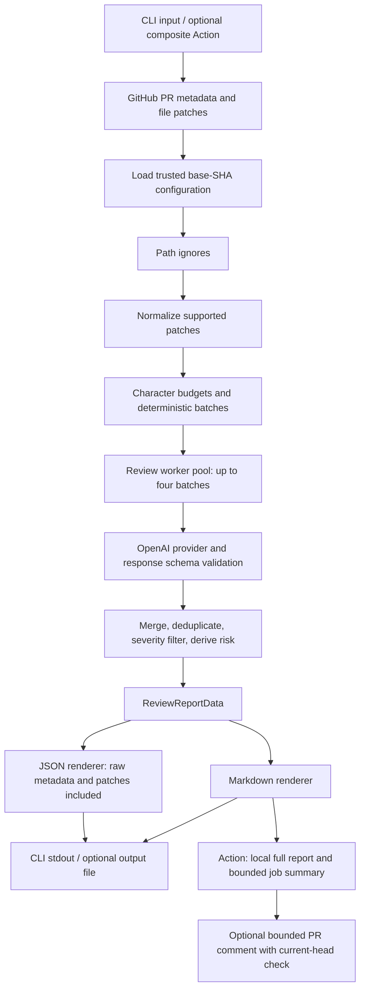

# Architecture

The CLI is a single process. It fetches PR metadata/patches and configuration from the trusted PR base SHA. It does not clone the repository, execute contributor code, or run tests.

## Boundaries

- `src/cli/` parses options and orchestrates fetch, trusted configuration, provider, engine, and rendering.
- `src/github/` owns Octokit access, retry/error handling, and PR response conversion. Comment discovery/publication is an optional write boundary, separate from review fetching.
- `src/config/` reads environment configuration and validates base-commit repository settings. Rules remain untrusted guidance, not system instructions.
- `src/review/ignore.ts` applies glob exclusions **before** `normalize.ts` classifies binary/patchless content. `batching.ts` skips oversized patches and deterministically groups the remainder within character limits.
- `src/review/reviewer.ts` schedules up to four provider calls, preserves batch result ordering, and stops scheduling after a failure while active calls settle. `schema.ts` validates result shape; `severity.ts` deduplicates and filters findings.
- `src/ai/` owns the OpenAI SDK and provider response parsing behind `ReviewProvider`. `src/review/prompt.ts` builds the prompts. Only OpenAI is implemented. The prompt marks repository data as untrusted; prompt wording is not a guarantee against model mistakes.
- `src/report/` renders Markdown or directly serializes report data to JSON. JSON currently includes original PR body and patches and has no schema version.
- `action.yml` builds/runs the trusted Action checkout. `src/action/` validates event/input boundaries and writes a local full report plus a summary capped at 900 KiB. It does not upload that report as an artifact.
- `src/github/comments.ts` checks tool ownership and current head before optional publication. `comment-safety.ts` independently bounds and sanitizes comment text. Publication remains best-effort under concurrency.
- `src/evaluation/` is a separate offline command. It reads saved reports and explicitly supplied labels/anchors; it does not call providers, execute repository code, or influence review results.

The Action uses `pull_request`, read permissions for summary mode, and explicit `pull-requests: write` for comments. It does not execute the contributor checkout or bypass fork-secret restrictions. See [security](../SECURITY.md) and [Action limitations](github-actions.md).
